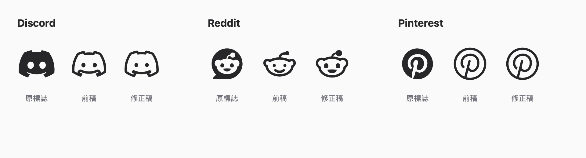

# 品牌線條版回修與可調線寬

後續使用者指出同設定的品牌實際線寬不同；此輪線寬結論已由 [Craft 04 原生線寬校準](../brand-outline-craft-04/decisions.md) 修正。以下保存當時紀錄。

2026-11-18 · 依使用者四項回饋修正。前輪 Discord、Reddit、Pinterest 的結論已撤回，保存前稿供對照。這份記錄區分 Codex 的視覺檢查與使用者定案；未宣稱使用者已核准新稿。

[原圖／前稿／修正稿與 18 顆線寬檢查](index.html)

| 項目 | 問題與處理 | 原生尺寸觀察 |
|---|---|---|
| Discord | 前輪內描擠壓下緣缺口，形成厚塊。回到原 Clyde 路徑的中心線描繪，恢復較輕的輪廓；保留原頭寬、雙眼中心與兩側腳端。 | 16px 下緣較輕；20/24px 腳端與頭形仍保持原比例。沒有沿用前輪「保留外邊界所以更好」的結論。 |
| Reddit | 前輪頭形過扁、耳朵太小，細笑弧偏離原 Snoo。按原檔恢復頭形、耳朵、雙眼與填色笑嘴；嘴巴沿用原寬上緣、圓下腹的路徑。 | 16px 的眼睛與笑嘴仍分開；20/24px 的面部比例和原圖更接近。原圓底不納入 outline，仍屬 Master 的線條詮釋。 |
| Pinterest | 左側缺口原本是截短曲線，缺少和斜筆的幾何關係。現在完整左回環作後景，將右側長筆的實際墨形向外擴張 1.2 單位，再扣除交疊區。 | 缺口是真透明，切邊跟隨長筆外緣；調粗、調細都重新計算，不能由圓端帽取代。右回環與長筆的結構接點保留。 |
| 18 個 outline 線寬 | 每個原生尺寸使用既有的 strokeWidth 範圍，在製作端重新計算墨形；預設圖稿不因新增支援而整批重畫。較粗的內描版本向預設墨線兩側增重，避免只向內擠壓窄字形的孔洞。 | 檢查 16／20／24px 的最細、預設、最粗，明暗 DPR 1／2。眼點、字樣、原聲波及紙飛機等實心識別細節保持原形；角型控制不重塑品牌特有的角。Facebook／TikTok 的極粗版本仍較密，預設線寬保留較完整的字形空腔。 |
| icons 列表 | 18 個 outline 分別直接列出，點入即選中線條版。原標誌與線條版仍可互相切換。 | 品牌分類有 106 個項目：88 個品牌識別及 18 個線條版本。OpenAI／ChatGPT 仍只顯示一份圖稿，兩個匯入名稱相容。Master 沒有 outline。 |

線寬沿用現有 API，例如 `BrandRedditOutlineIcon` 的 `strokeWidth={1.5}`。JS、React、Preact、Vue、Svelte、Astro、固定尺寸入口、列表預覽、詳情、複製程式碼及 SVG／ZIP 下載都取用同一批生成幾何。

來源不變：Discord 與 Reddit 的品牌輪廓參考固定 Simple Icons 原檔；Reddit 及 Pinterest 的線條構成承接既有 Tabler 改作，保留 MIT 聲明。`source.identitySource`、母稿 SHA-256 與原始來源檔仍可追溯。這些不是品牌官方核准資產。

前稿位於 `before/`。編輯母稿位於 `references/brand-outlines/authoring/`；權重計算與透明扣除在 `scripts/lib/brand-ink.mjs`，只於製作端執行，不把幾何引擎帶入消費端。`scripts/review-brand-outline-craft-03.mjs` 可重建對照頁。單顆檢查與權重截圖的 hash 記錄於 [decisions.json](decisions.json)。

網站建置另加入與資產生成共用的鎖，避免開發 watcher 替換 `public/` 時 Astro 正在複製下載檔，導致部分線寬目錄未進入靜態輸出。瀏覽器測試直接下載最細與最粗 SVG，比較實際檔案和詳情程式碼，而不只檢查 href 字串。

驗證完成：63 項套件測試、33 項 Chromium／Firefox／WebKit 網站測試及 2 項離線圖庫測試通過；框架型別、網站型別與 Master UI 合約檢查通過。810 份可調線寬 SVG 與 6 份極端線寬 ZIP 中的 108 份圖稿逐一比對一致。窄螢幕截圖等待對話框轉場完成後重拍，3 個瀏覽器再驗通過。完整數字與介面截圖雜湊見 [verification.json](verification.json)。

