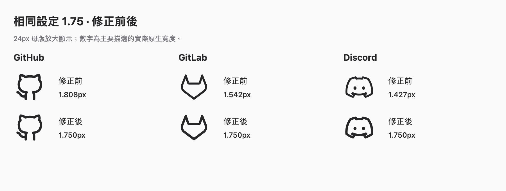

# 品牌 outline 原生線寬校準

後續的 [18 顆視覺重量與留白複審](../brand-outline-craft-05/decisions.md) 保留本輪主要線寬，進一步修正 WeChat 的氣泡交界和 SoundCloud 的短棒配置。

2026-11-18 · 依使用者「相同線寬看起來不同」回饋修正。

前輪只用「設定值／原生預設」當作母稿線寬倍率，再將墨形縮放至各品牌的光學佔幅，沒有抵銷這個縮放。因此 GitHub、GitLab、Discord 設定同為 1.75 時，實際約為 1.808、1.542、1.427px。這是製作流程的問題，不能以品牌密度差異解釋。

現在將目標原生線寬除以光學縮放比例後，才展開描邊。18 個主要輪廓在 16／20／24 的預設為 1.25／1.5／1.75px；自訂線寬用同一流程。固定光學位置、角型、原始標誌、Master 和 OpenAI／ChatGPT 別名均保留。沿用的實心品牌細節與明確的次要描線比例保留；主描邊相同不代表圖形的整體墨量相同。

Facebook、TikTok、Vimeo 的細內描若直接增厚會擠壓空腔，因此改沿原輪廓中心描線，讓內外兩側分攤墨線。LinkedIn 移除 in 的額外加粗，與外框共用主線寬。Pinterest 的透明淨空仍依長筆實際外緣重新計算。

[原生對照與完整線寬範圍](index.html) · [逐顆資料及雜湊](decisions.json)

| 品牌 | 24px 預設主線寬 | 原生尺寸及來源回比 |
|---|---|---|
| wechat | 1.463 → 1.750px | 主氣泡與前景小氣泡同時補足線寬；16px 兩組眼點仍可分開，24px 與 GitHub 混排不再偏細。 |
| github | 1.808 → 1.750px | 取消光學縮放造成的額外增重，24px 主描邊由約 1.808 降至 1.75；頭形、耳尖與雙腿保留。 |
| gitlab | 1.542 → 1.750px | 24px 約 1.542 補至 1.75；上方水平橋與斜面同樣增重，耳峰和下頷仍保持原比例。 |
| discord | 1.427 → 1.750px | 24px 約 1.427 補至 1.75；下緣凹口跟隨主描邊，眼點不加粗，與 GitHub 不再有系統性的主線寬落差。 |
| youtube | 1.444 → 1.750px | 外框補足線寬，圓角與長寬比保留；內部三角形維持原有較細比例，以留出原生 16px 的播放孔。 |
| facebook | 1.181 → 1.750px | 改沿原 f 輪廓中心描線，增重分配到兩邊；原生預設與最粗仍有直幹及橫槓空腔，沒有沿用細內描掩飾擁擠。 |
| linkedin | 1.375 → 1.750px | 外框與 in 同用主描邊，移除內部字樣額外增重；原生 16px 的 i 圓點與直幹仍分開。 |
| mastodon | 1.458 → 1.750px | 外框與 m 同時校準；預設下雙拱和底部折返仍可讀，極粗版本密度較高。 |
| reddit | 1.449 → 1.750px | 臉部輪廓補足主線寬；沿用前輪原圖眼睛與填色笑嘴，天線維持較細的從屬比例。 |
| spotify | 1.375 → 1.750px | 圓框按輸出尺寸校準，三道品牌聲波保留原粗細遞變；不是把聲波誤當成同寬操作線條。 |
| soundcloud | 1.467 → 1.750px | 雲朵主輪廓補足線寬，四道短棒保留較細比例和分組；極粗時短棒間隙較緊，預設仍可分辨。 |
| pinterest | 1.375 → 1.750px | 圓環與 P 回環、長筆同步校準；左缺口繼續由長筆實際外緣等距扣除，粗細兩端仍透明。 |
| tiktok | 1.167 → 1.750px | 由內描改沿原輪廓中心描線，為較厚的雙邊輪廓騰出直幹空腔；機身弧線、左斷面及右旗不改形。 |
| twitch | 1.417 → 1.750px | 外輪廓補足主線寬，兩個原實心矩形槽保持固定；斜切、尾尖的辨識未因線寬校準丟失。 |
| vimeo | 1.083 → 1.750px | 由內描改沿原輪廓中心描線；左上挑與右上反彎仍跟原標誌，較粗時下腹內部保留空腔。 |
| patreon | 1.375 → 1.750px | 不對稱塊形輪廓整體補足線寬，保留右上圓肩和偏左下收束；沒有將輪廓規整成通用字母。 |
| telegram | 1.375 → 1.750px | 圓框補足主線寬，紙飛機仍用固定原始填色路徑；預設及極粗框與機鼻仍分開。 |
| line | 1.356 → 1.750px | 氣泡框補足主線寬，LINE 字樣維持原比例；尾部與字標在 16/20/24 可分辨。 |

目視：Codex 檢查原生 16／20／24、明暗背景、DPR 1／2、最細／預設／最粗。這是 AI 視覺檢查紀錄，不代表使用者已定案。每顆以原標誌並列檢查輪廓比例；原始來源和授權沒有改變。

工程回歸另直接量測生成 SVG 的主要輪廓法線截面，涵蓋 18 品牌 × 15 尺寸／線寬組合；不把 SVG 的 stroke-width 屬性視為實際墨線寬度。

驗證結果：63 項套件測試、33 項網站測試及 18 項圖庫／線寬測試通過。三瀏覽器共量測 810 個主要描邊截面；另比對 810 份下載 SVG、6 份極端線寬 ZIP 中的 108 份品牌圖稿。資產驗證通過 942 個命名圖稿、8478 個 SVG hash 與 9 份授權 ZIP。詳見 [verification.json](verification.json) 與 [measurements.json](measurements.json)。

