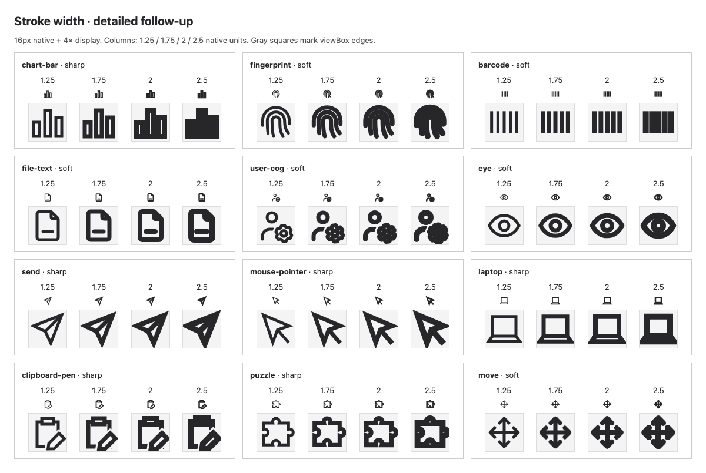

# Stroke width 01：可調線寬與全庫檢查

> 歷史紀錄：本頁的統一 0.75–2.5 範圍與待修問題已由 [Stroke width 02](stroke-width-02.md) 的分尺寸範圍、31 顆精修及全庫複查取代。以下保留第一輪檢查結果。

2026-11-17。網站圖示工具與離線預覽均新增線寬 slider：**0.75–2.5，間距 0.25**，提供即時數值、鍵盤操作與重設。線寬以原生 viewBox 單位計算，隨顯示尺寸縮放；重設後使用 16／20／24px 母版原定的 1.25／1.5／1.75 線寬。

選取值同步圖庫、尺寸比較、詳情、SVG 程式碼、React JSX、單檔與整組 ZIP；網站 URL 保留 `stroke`。自訂線寬的 React 複製內容是實際 SVG JSX。套件既有預製輪廓沒有新增任意 `strokeWidth` 重算能力。

## 檢查結果

**工具功能完成；粗線寬下仍有圖稿瑕疵，不能將整庫標記為全範圍合格。**

| 項目 | 範圍或結果 |
| --- | --- |
| 圖示 | 392 顆，全部納入總覽圖目視檢查 |
| 母版 | 16／20／24 × sharp／soft／rounded，共 3,528 組 |
| 線寬 | 0.75、1、1.25、1.5、1.75、2、2.25、2.5 |
| 自動渲染 | DPR 1／2，共 56,448 個案例，沒有空白圖示 |
| 越界 | 46 顆、382 個含 DPR 的案例，具體組合見 ledger |
| 內孔減少 | 73 顆、623 個 DPR 2 案例，屬複查訊號，不等於 73 顆全部已確認失敗 |
| 原生母版 | 3,528 組原始 nodes 比對完全相同 |
| 自訂版在原生線寬的比對 | 3,528 組於 4× 渲染；最大相對 alpha 差異約 2.595%，低於 4% 回歸門檻 |

[逐顆 ledger](review/stroke-width-01/ledger.json) 記錄全部 392 顆的檢查頁、144 個案例、越界組合、內孔訊號與原生差異；[完整旗標](review/stroke-width-01/flags.json) 保留尺寸、角型、線寬、DPR 與實際墨跡邊界。[摘要](review/stroke-width-01/summary.json) 與[原生像素比對](review/stroke-width-01/native-parity.json) 可供程式核對。沒有自動旗標代表沒有觸發這兩項篩查，並非視覺品質保證。

## 已確認的視覺問題

下列是已在原生大小及放大對照確認的代表案例。它們仍保留在工具中，供線寬檢查與後續逐顆精修，沒有透過縮放整顆圖示掩蓋問題。

| 圖示與條件 | 問題 |
| --- | --- |
| chart-bar，16 sharp，2.5 | 柱體內孔消失，底部相接 |
| fingerprint，16 soft，2–2.5 | 指紋線黏合，2.5 接近實心塊 |
| barcode，16 soft，2.5 | 條碼間隙過窄；開放間隙不會被孔洞計數捕捉 |
| user-cog，16 soft，2–2.5 | 齒輪孔與齒隙消失，2.5 成實心徽標 |
| eye，16 soft，2.5 | 瞳孔輪廓與外框相接 |
| file-text，16 soft，1.75–2.5 | 摺角內孔消失，2.5 文字線接近底框 |
| send／mouse-pointer，16 sharp，1.75 起 | 尖角或箭尾超出畫布 |
| laptop／clipboard-pen／puzzle，16 sharp，1.5 起 | 底座、筆尖或凸榫超出畫布 |
| move，16 soft，2.5 | 相鄰箭翼黏合；與此次已修正的端點遺失問題不同 |



[深色對照](review/stroke-width-01/examples-dark.png)／[可直接開啟的 SVG 對照頁](review/stroke-width-01/examples.html)。圖中的灰底邊框代表 viewBox；放大圖只用於看接合、裁切與負空間，原生圖仍是辨識度的主要判準。

下一輪應先處理 16px 的越界與語意細節消失，再逐顆決定需要內縮、增加間距或另畫粗線寬母版；不能只靠全域線寬或統一縮小解決。0.75–2.5 是工具的檢查範圍，並非整庫的品質承諾。

## 此次修正

原有遮擋、結構接縫與箭頭接合含已展開的填色輪廓，單改 SVG 根節點的 `stroke-width` 會留下固定粗細的部分。工具現由繪圖原始幾何產生各檔線寬，使用可保留線寬變化的遮罩處理接合與前景淨空；標準套件仍維持既有 PathKit 輸出。

修正嵌套節點在旋轉／鏡像時遺失、`move` 組合箭頭只取前兩個節點導致端點遺失，以及 16px `file-archive` 細線未隨主線寬改變。前景避讓沿實際描邊輪廓外擴，保留 sharp 的方端與尖角，不只加粗中心線。預設母版的 nodes 未改變。

## 驗證與重現

在專案根目錄執行：

```sh
bun run build
node scripts/review-strokes.mjs
node scripts/check-stroke-parity.mjs
bun run validate
```

完整矩陣位於 `work/stroke-width/review/index.html`：25 組頁面，每頁 16 顆以原生 16／20／24px 呈現九母版與八線寬，並產生淺／深色、DPR 1／2 共 100 張圖。全庫總覽圖目視掃描後，再針對密集圖形、越界與遮罩接合放大複查。原始 56,448 筆資料位於同目錄 `metrics.json`。這些大量產物列入 gitignore，可由上述指令重建。

邊界篩查在 viewBox 外加 4px 留白，使用 alpha > 8/255 的墨跡邊界判定。孔洞篩查在 DPR 2 以 alpha 128 分隔，與相同母版的原生線寬相比；抗鋸齒、刻意接觸或開放間隙均可能影響結果，因此不能取代目視。原生差異測試使用 alpha 差總和除以原版墨跡面積，4% 門檻用來捕捉遺失部件，並非肉眼品質評分。

通過：網站建置、型別檢查、Master UI（17 檔 0 錯誤／警告）、i18n audit、圖庫 validate、套件 36 項測試與公開 API 型別測試。網站 Chromium／WebKit 共 32 項測試通過；最後箭頭修正後再跑 6 項線寬專項測試通過。確認 URL、重設、鍵盤、詳情九母版、SVG／ZIP 內容相符，以及離線工具的線寬操作。Firefox 本機啟動失敗（Could not find profile folder），未完成驗證。

介面已檢查桌面與窄螢幕、淺／深色：[桌面淺色](review/stroke-width-01/ui-desktop-light.png)、[桌面深色](review/stroke-width-01/ui-desktop-dark.png)、[手機淺色](review/stroke-width-01/ui-mobile-light.png)、[手機深色](review/stroke-width-01/ui-mobile-dark.png)。
